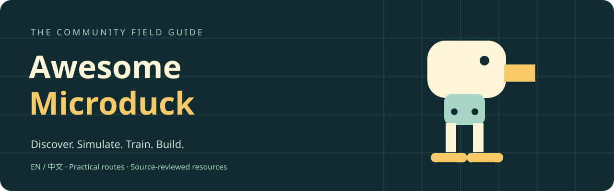

# Awesome Microduck

**A curated and continuously reviewed map of the Microduck ecosystem.**

Discover simulators, policies, agent tools, hardware builds and experiments — with practical notes on what works today and what remains unproven.

⭐ **Star this repository to follow the Microduck ecosystem.**

English · [简体中文](README.zh-CN.md) · [Start here](docs/getting-started.md) · [Contribute](CONTRIBUTING.md)

## 🆕 What's new

### 2026-10-12

- 📦 Reviewed official stable **[daemon v0.16.1](https://github.com/pollen-robotics/microduck/releases/tag/daemon-v0.16.1)** — the v0.15.3–v0.16.1 sequence brings beta-board support, safer gamepad-dropout behavior, battery display and a Rustls security update; v0.15.3 explicitly lacked robot validation.
- ⚖️ Recorded the official **[Microduck RL license clarification](https://github.com/pollen-robotics/microduck_rl/commit/7cc1961674f78d4fca7064fde715e0c9bcd7b9c4)** — bundled STL meshes are CC BY-NC-SA 4.0, while code, MJCF and other listed files remain Apache-2.0.
- 🔧 Updated **[Microduck replica](https://github.com/fanhao375/microduck-replica/commit/75c2b4b3249a8a4a17e29dabb872ebb465c393f9)** after a BNO085, 15-servo loop, HOME and a 10-second policy hold ran on hardware; continuous walking remains blocked by thermal throttling and unverified.
- 🤖 Re-reviewed **[MicroDuck ROS 2 + Isaac Sim](https://github.com/osrbot/microduck-ros2-isaac/commit/2adc4b157fc732d4751ad97577e4ea39bd727abd)** for its v7 policy pins and bilingual upstream alignment; converted USD/GPU playback still awaits revalidation and there is no physical driver.
- 🧱 Added **[MicroDuck Jetson Orin Nano mount](https://github.com/adammong/microduck-jetson-mount)** — printable parametric CAD and measured MuJoCo payload-policy studies, with hardware fit, strength and control explicitly untested.

### 2026-10-08

- 📦 Reviewed official **[daemon v0.15.2](https://github.com/pollen-robotics/microduck/releases/tag/daemon-v0.15.2)** — motion caps are configurable, shutdown eases into the recorded rest pose, and an active policy pauses while the robot is held; v0.15.1 also hardened provisioning and updater checks.
- 🧠 Reviewed the official **[policy set v7](https://huggingface.co/pollen-robotics/microduck-policies/tree/v7)** — v6 reduces backward tipping during abrupt seated head motion, while v7 restores standing roll/pitch control; both are author-reported as real-robot validated, and v7 still does not learn crouch.
- 🧪 Updated **[Microduck Playground](https://github.com/Vottivott/microduck-playground)** and **[Microduck Lab](https://github.com/jonathanhawkins/microduck-lab)** for new long-jump/backflip experiments and richer multi-robot browser worlds; these remain simulation results.
- ⚠️ Flagged the **[XGO Duck connector correction](https://github.com/LuwuDynamics/xgoduck_hardware/blob/63b1c45/PCBA/README.md)** — older boards can reverse GND and signal on U3, U4 and U5 and must be checked before power-up.
- 🧰 Added **[DuckKit](https://github.com/craigm26/duckkit)** and **[quackd](https://github.com/rokbenko/quackd)** for Swift-native integration and goal-directed/MCP experiments; neither has validated Microduck hardware control.

### 2026-09-29

- 📡 Reviewed official **[daemon v0.15.0](https://github.com/pollen-robotics/microduck/releases/tag/daemon-v0.15.0)** — stable telemetry now carries joint velocity and load, and the docs add a server-side agent route; later `daemon-dev-*` builds remain prereleases.
- 🧩 Updated **[Microduck Playground](https://github.com/Vottivott/microduck-playground)** with its documented chimney-climb simulation and published policies; physical-hardware behavior is still untested.
- 🔧 Re-reviewed **[Microduck replica](https://github.com/fanhao375/microduck-replica)** — the HD-1910 build is assembled and reports pose control plus joint readback, but not a complete IMU-policy loop or walking.
- 🦆 Added **[XGO Duck](https://github.com/LuwuDynamics/xgoduck_hardware)** — an Arduino Uno Q and Feetech adaptation with open build files, runtime and training code, backed by author-published hardware demos.

### 2026-09-21

- 📱 Reviewed official **[daemon v0.14.1](https://github.com/pollen-robotics/microduck/releases/tag/daemon-v0.14.1)** — phone controls can now stand the robot up and start a policy; v0.14.0 also moved the MuJoCo twin onto the real runtime daemons.
- 🌐 Added **[Microduck Web](https://github.com/TonyRuan/microduck-web)** — a community browser simulator with touch controls and ONNX policy import; it does not control hardware.
- 📚 Added **[OpenMicroDuck](https://github.com/SaberOnGo/open-microduck)** — a bilingual learning and research guide that separates official facts, community reconstruction and unresolved questions.
- 🧰 Added **[Fanduck](https://github.com/7757/fanduck)** — a completed community replica with author-published hardware footage and packaged build files; check its non-commercial model terms.

### 2026-09-16

- 🧠 Added **[microduck-mcp](https://github.com/joeynyc/microduck-mcp)** — an agent interface with mock and simulation support; real-device transports remain hardware-unverified.
- 🍎 Added **[Microduck Lab](https://github.com/jonathanhawkins/microduck-lab)** — local Microduck experiments for Apple Silicon, with a browser viewer.
- 🔧 Added **[Microduck replica](https://github.com/fanhao375/microduck-replica)** — reconstruction notes, CAD and build logs; check the actuator variant and completion status.
- ⚠️ Reviewed **[isaaclab-microduck](https://github.com/kabilankb/isaaclab-microduck)** — its README reports unsuccessful locomotion; treat it as task-port research, not a ready walking policy.

→ [See all review notes](docs/updates.md)

## Choose your route

| What you have | Start here | First milestone |
| --- | --- | --- |
| A browser | [Official sandbox](https://huggingface.co/spaces/pollen-robotics/microduck-simulator) | Observe and control a simulated duck |
| An Apple Silicon Mac | [Microduck Lab](https://github.com/jonathanhawkins/microduck-lab) | Reproduce a local simulation |
| An NVIDIA CUDA setup | [Official RL stack](https://github.com/pollen-robotics/microduck_rl) | Confirm dependencies and list training tasks |
| An AMD Linux workstation | [Genesis port](https://github.com/Macmachi/microduck-rl-genesis) | Check the project's tested ROCm setup |
| ROS 2 experience | [ROS 2 tutorial](https://github.com/osrbot/microduck-ros2-isaac) | Inspect the model in RViz |
| A DIY workbench | [Build tutorial](https://github.com/AI-FanGe/Microduck-build-tutorial) | Match one complete hardware configuration |
| An agent integration idea | [MCP project](https://github.com/joeynyc/microduck-mcp) | Exercise the mock path before simulation |

Read the [step-by-step routes and common traps](docs/getting-started.md).

## Browse the ecosystem

[Official](#official) · [Documentation](#documentation) · [Simulation](#simulation-and-training) · [Policies](#policy-experiments) · [Tools](#developer-and-agent-tools) · [Hardware](#hardware-and-diy)

Each entry includes its environment, evidence status and review date. [How to read the labels](#how-resources-are-reviewed).

<!-- Future categories: Examples & Demos; Community Projects; Hardware Mods;
CAD / 3D Printing; Sensors & Accessories; Vision / VLA / Agents;
Training Recipes; Videos & Tutorials; Research & Experiments.
Introduce a category only when reviewed resources justify it; never publish empty sections.
Keep catalog generation in sync when introducing a category. -->

<!-- RESOURCES:START -->

### Official

- [Microduck RL](https://github.com/pollen-robotics/microduck_rl) — Official CUDA training workspace with v7 lineage and Hub publishing; bundled STL meshes are CC BY-NC-SA 4.0 while the remaining files stay Apache-2.0. **CUDA** · `official` · [Source](https://github.com/pollen-robotics/microduck_rl/commit/7cc1961674f78d4fca7064fde715e0c9bcd7b9c4) · 2026-10-12.
- [Microduck runtime](https://github.com/pollen-robotics/microduck) — Official runtime and operator docs; stable v0.16.1 adds beta-board IMU, NFC, camera and LED support, battery display and sit-on-gamepad-dropout behavior. **Robot / simulation** · `official` · [Source](https://github.com/pollen-robotics/microduck/releases/tag/daemon-v0.16.1) · 2026-10-12.
- [Microduck Sandbox](https://huggingface.co/spaces/pollen-robotics/microduck-simulator) — Try the hosted simulator before choosing a local setup. **Browser** · `official` · [Source](https://huggingface.co/spaces/pollen-robotics/microduck-simulator) · 2026-09-16.
- [Official policy files](https://huggingface.co/pollen-robotics/microduck-policies) — Official v7 ONNX set; authors report real-robot validation for safer seated head moves and standing roll/pitch control, while crouch remains unlearned. **ONNX** · `official` · [Source](https://huggingface.co/pollen-robotics/microduck-policies/tree/v7) · 2026-10-08.

### Documentation

- [Documentation index](https://github.com/pollen-robotics/microduck/blob/main/docs/README.md) — Find the relevant operator or developer guide. **Reading** · `official` · [Source](https://github.com/pollen-robotics/microduck/blob/main/docs/README.md) · 2026-09-16.
- [Official daemon releases](https://github.com/pollen-robotics/microduck/releases) — Track stable daemon releases separately from signed development builds. **Reading / release artifacts** · `official` · [Source](https://github.com/pollen-robotics/microduck/releases/tag/daemon-v0.16.1) · 2026-10-12.
- [OpenMicroDuck](https://github.com/SaberOnGo/open-microduck) — Community guide spanning simulation, training and DIY research; keep its source labels and unresolved hardware questions in view. **Bilingual guide** · `experimental` · [Source](https://github.com/SaberOnGo/open-microduck) · 2026-09-21.
- [Policy manifest reference](https://github.com/pollen-robotics/microduck/blob/main/docs/policy-manifest.md) — Check policy metadata and compatibility requirements. **Reading** · `official` · [Source](https://github.com/pollen-robotics/microduck/blob/main/docs/policy-manifest.md) · 2026-09-16.
- [Robot command reference](https://github.com/pollen-robotics/microduck/blob/main/docs/robot/cheatsheet.md) — Look up commands for the installed runtime version. **Reading** · `official` · [Source](https://github.com/pollen-robotics/microduck/blob/main/docs/robot/cheatsheet.md) · 2026-09-16.
- [Runtime simulation guide](https://github.com/pollen-robotics/microduck/blob/main/docs/robot/simulation.md) — Run the real runtime daemons against MuJoCo bodies; physical buses and device drivers remain outside the simulation. **Reading** · `official` · [Source](https://github.com/pollen-robotics/microduck/blob/main/docs/robot/simulation.md) · 2026-09-21.

### Simulation and training

- [isaaclab-microduck](https://github.com/kabilankb/isaaclab-microduck) — Task-port research. The reviewed README reports unsuccessful locomotion; do not select it as a ready walking policy. **Isaac Lab / CUDA** · `experimental` · [Source](https://github.com/kabilankb/isaaclab-microduck) · 2026-09-16.
- [Microduck Lab](https://github.com/jonathanhawkins/microduck-lab) — Apple Silicon and CPU training lab with browser worlds, multi-duck soccer and tidying behaviors; all reviewed results remain simulation-only. **Apple Silicon / CPU** · `simulation-reported` · [Source](https://github.com/jonathanhawkins/microduck-lab/commit/bbf0326) · 2026-10-08.
- [Microduck RL on Genesis](https://github.com/Macmachi/microduck-rl-genesis) — An AMD-oriented training alternative; follow its tested configuration. **Linux / AMD ROCm** · `simulation-reported` · [Source](https://github.com/Macmachi/microduck-rl-genesis) · 2026-09-16.
- [MicroDuck ROS 2 + Isaac Sim](https://github.com/osrbot/microduck-ros2-isaac) — ROS 2 Jazzy viewer and Isaac Sim/Lab tutorials now pin the official v7 policies; the converted USD and GPU playback still await revalidation, and there is no physical driver. **ROS 2 Jazzy / optional Isaac Sim** · `simulation-reported` · [Source](https://github.com/osrbot/microduck-ros2-isaac/commit/2adc4b157fc732d4751ad97577e4ea39bd727abd) · 2026-10-12.
- [Microduck Web](https://github.com/TonyRuan/microduck-web) — Community MuJoCo and ONNX simulator with touch controls and policy import; it does not control physical hardware. **Browser / mobile / offline cache** · `simulation-reported` · [Source](https://github.com/TonyRuan/microduck-web) · 2026-09-21.
- [microduck-rl-torch](https://github.com/bsprenger/microduck-rl-torch) — Explore a portable PyTorch implementation; check backend limitations first. **PyTorch / CPU / GPU** · `experimental` · [Source](https://github.com/bsprenger/microduck-rl-torch) · 2026-09-16.

### Policy experiments

- [Microduck Playground](https://github.com/Vottivott/microduck-playground) — Reproducible simulations cover chimney climbing, a raised-platform long jump and a backflip with published policies; hardware remains untested and the backflip carries a breakage warning. **Simulation** · `simulation-reported` · [Source](https://github.com/Vottivott/microduck-playground/commit/f010ef1) · 2026-10-08.

### Developer and agent tools

- [DuckKit](https://github.com/craigm26/duckkit) — Zero-dependency Swift implementation of the policy, observation, kinematics and RPC contracts; author reports 347 offline tests but no hardware validation. **Swift / Linux / Apple** · `experimental` · [Source](https://github.com/craigm26/duckkit/releases/tag/v1.37.0) · 2026-10-08.
- [Microduck Studio](https://github.com/microai-lab/microduck-studio) — A development interface joining runtime and simulation; requires sibling repositories. **Local / Docker launcher** · `experimental` · [Source](https://github.com/microai-lab/microduck-studio) · 2026-09-16.
- [microduck-mcp](https://github.com/joeynyc/microduck-mcp) — Agent interface with mock and simulation paths. Its README states real-device transports have only fake-daemon validation. **Node.js / mock / simulation** · `hardware-unverified` · [Source](https://github.com/joeynyc/microduck-mcp) · 2026-09-16.
- [quackd](https://github.com/rokbenko/quackd) — Goal-directed robot CLI and MCP bridge with Microduck mock and MuJoCo paths; its JSON-RPC hardware backend has only pinned-name fake validation. **Python 3.12 / mock / MuJoCo / MCP** · `hardware-unverified` · [Source](https://github.com/rokbenko/quackd/releases/tag/v0.17.1) · 2026-10-08.

### Hardware and DIY

- [Fanduck](https://github.com/7757/fanduck) — Completed community replica with author-published hardware footage and packaged BOM, print and board files; review the non-commercial model terms. **DIY / CAD / PCB** · `hardware-demo-reported` · [Source](https://github.com/7757/fanduck) · 2026-09-21.
- [Microduck build tutorial](https://github.com/AI-FanGe/Microduck-build-tutorial) — Chinese assembly and setup guide with author-published hardware clips; its configuration differs from the official product. **DIY / Raspberry Pi** · `hardware-demo-reported` · [Source](https://github.com/AI-FanGe/Microduck-build-tutorial) · 2026-09-16.
- [MicroDuck Jetson Orin Nano mount](https://github.com/adammong/microduck-jetson-mount) — Parametric external-compute mount with printable CAD and reproducible payload-policy studies; fit, strength and control results remain simulation-only. **CAD / MuJoCo / Jetson Orin Nano** · `simulation-reported` · [Source](https://github.com/adammong/microduck-jetson-mount/commit/8d361ceae40c8474e43468bfbd2d311344387fa1) · 2026-10-12.
- [Microduck replica](https://github.com/fanhao375/microduck-replica) — The HD-1910 build now reports a BNO085, 15-servo control loop, HOME and a 10-second policy hold on hardware; continuous walking remains unverified after thermal throttling. **CAD / electronics / DIY** · `hardware-demo-reported` · [Source](https://github.com/fanhao375/microduck-replica/commit/75c2b4b3249a8a4a17e29dabb872ebb465c393f9) · 2026-10-12.
- [XGO Duck](https://github.com/LuwuDynamics/xgoduck_hardware) — Arduino Uno Q adaptation with author hardware demos; pre-2026-10-02 boards require a documented U3, U4 and U5 GND/signal wiring check before power-up. **DIY / Arduino Uno Q / Feetech 1910** · `hardware-demo-reported` · [Source](https://github.com/LuwuDynamics/xgoduck_hardware/blob/63b1c45/PCBA/README.md) · 2026-10-08.
<!-- RESOURCES:END -->

## How resources are reviewed

Resources are reviewed against upstream documentation, demos and published evidence. Status labels distinguish the publisher and what is currently demonstrated, rather than planned support. Source review does not imply independent testing.

| Label | What it tells you |
| --- | --- |
| `official` | Published by upstream; identifies provenance, not a test result |
| `simulation-reported` | Authors report simulation results |
| `hardware-demo-reported` | Authors publish physical-hardware demonstrations |
| `experimental` | Research or integration work with current limitations |
| `hardware-unverified` | Real-device validation is not established |

This weekly update was source-reviewed on **2026-10-12**; per-entry dates show the last individual review. This list has not independently run the projects.

[Read the full review policy](docs/review-policy.md)

## Keep exploring

- [Getting started / 入门路线](docs/getting-started.md): choose a setup and define a reproducible first result.
- [Review notes / 更新记录](docs/updates.md): new projects, tools, hardware and important progress.
- [Machine-readable catalog](data/resources.json): bilingual descriptions, evidence links and review dates.
- For curated release notifications, use GitHub **Watch → Custom → Releases**. Review notes will accompany releases when published.

## Contributing

Found a new project, hardware mod, sensor, accessory or training recipe? [Contribute a resource or correction](CONTRIBUTING.md) with its requirements, demonstrated results and limitations.

We also welcome charging docks, grippers, additional actuators and vision / VLA / multimodal control experiments. Include evidence of what works today; new categories will appear as reviewed resources arrive.

## Credits and license

Independent community resource; not affiliated with Pollen Robotics or Hugging Face.

Inspired by [joeynyc/awesome-microduck](https://github.com/joeynyc/awesome-microduck), particularly its ecosystem-navigation approach and resource organization. Thanks to the project for helping map the early Microduck community.

Original catalog text, documentation and banner: [CC0](LICENSE). Linked code, model weights, CAD and media retain their own licenses; inclusion grants no additional rights.
