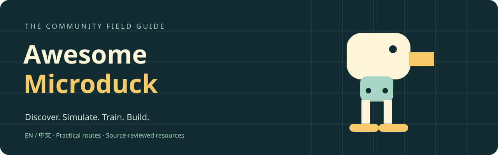

# Awesome Microduck

**一份持续追踪、精选并核验的 Microduck 生态地图。**

发现仿真器、运动策略、Agent 工具、硬件构建与实验项目，了解它们适合谁、当前能做什么，以及哪些能力仍待验证。

⭐ **Star 本仓库，持续关注 Microduck 生态进展。**

[English](README.md) · 简体中文 · [入门路线](docs/getting-started.md) · [贡献资源](CONTRIBUTING.md)

## 🆕 最新动态

### 2026-09-16

- 🧠 收录 **[microduck-mcp](https://github.com/joeynyc/microduck-mcp)**：支持 mock 与仿真的 Agent 接口；真机传输仍未经过硬件验证。
- 🍎 收录 **[Microduck Lab](https://github.com/jonathanhawkins/microduck-lab)**：面向 Apple Silicon 的本地 Microduck 实验，配有浏览器可视化。
- 🔧 收录 **[Microduck replica](https://github.com/fanhao375/microduck-replica)**：逆向结构、CAD 与装机记录；需区分舵机版本和当前完成状态。
- ⚠️ 核验 **[isaaclab-microduck](https://github.com/kabilankb/isaaclab-microduck)**：README 明示行走尚未成功，应作为任务移植研究，而非现成行走策略。

→ [查看全部更新记录](docs/updates.md)

## 按你的设备开始

| 你现在有什么 | 建议入口 | 第一个目标 |
| --- | --- | --- |
| 只有浏览器 | [官方在线仿真](https://huggingface.co/spaces/pollen-robotics/microduck-simulator) | 观察并控制仿真小鸭 |
| Apple Silicon Mac | [Microduck Lab](https://github.com/jonathanhawkins/microduck-lab) | 复现本地仿真 |
| NVIDIA CUDA 环境 | [官方 RL 工程](https://github.com/pollen-robotics/microduck_rl) | 核对依赖、列出可训练任务 |
| AMD Linux 工作站 | [Genesis 移植](https://github.com/Macmachi/microduck-rl-genesis) | 对照作者已测试的 ROCm 环境 |
| ROS 2 基础 | [ROS 2 教程](https://github.com/osrbot/microduck-ros2-isaac) | 在 RViz 查看模型 |
| 动手装机条件 | [中文装机教程](https://github.com/AI-FanGe/Microduck-build-tutorial) | 确认一套完整硬件配置 |
| Agent 接入想法 | [MCP 项目](https://github.com/joeynyc/microduck-mcp) | 先验证 mock，再进入仿真 |

查看[详细路线与常见问题](docs/getting-started.md)。

## 浏览 Microduck 生态

[官方入口](#official) · [文档](#documentation) · [仿真训练](#simulation-and-training) · [策略实验](#policy-experiments) · [开发工具](#developer-and-agent-tools) · [硬件复刻](#hardware-and-diy)

每项资源附有运行环境、证据状态与核验日期。[了解状态标签](#资源如何核验)。

<!-- 后续按资源积累扩展：Examples & Demos；Community Projects；Hardware Mods；
CAD / 3D Printing；Sensors & Accessories；Vision / VLA / Agents；
Training Recipes；Videos & Tutorials；Research & Experiments。
有已核验资源后再引入分类，不发布空章节；新增分类时同步目录生成脚本。 -->

<!-- RESOURCES:START -->

### 官方入口

- [Microduck RL](https://github.com/pollen-robotics/microduck_rl) — 官方训练工程；先检查环境要求与实时任务列表。 **CUDA** · `official` · [来源](https://github.com/pollen-robotics/microduck_rl) · 2026-09-16.
- [Microduck runtime](https://github.com/pollen-robotics/microduck) — 机器人运行软件与操作文档总入口。 **Robot / simulation** · `official` · [来源](https://github.com/pollen-robotics/microduck) · 2026-09-16.
- [Microduck Sandbox](https://huggingface.co/spaces/pollen-robotics/microduck-simulator) — 先在线体验仿真，再决定是否搭建本地环境。 **Browser** · `official` · [来源](https://huggingface.co/spaces/pollen-robotics/microduck-simulator) · 2026-09-16.
- [Official policy files](https://huggingface.co/pollen-robotics/microduck-policies) — 查找已发布权重；接入前对照运行时的 manifest 契约。 **ONNX** · `official` · [来源](https://github.com/pollen-robotics/microduck/blob/main/docs/policy-manifest.md) · 2026-09-16.

### 文档

- [Documentation index](https://github.com/pollen-robotics/microduck/blob/main/docs/README.md) — 按操作与开发需求查找上游文档。 **Reading** · `official` · [来源](https://github.com/pollen-robotics/microduck/blob/main/docs/README.md) · 2026-09-16.
- [Policy manifest reference](https://github.com/pollen-robotics/microduck/blob/main/docs/policy-manifest.md) — 核对策略元数据与兼容性要求。 **Reading** · `official` · [来源](https://github.com/pollen-robotics/microduck/blob/main/docs/policy-manifest.md) · 2026-09-16.
- [Robot command reference](https://github.com/pollen-robotics/microduck/blob/main/docs/robot/cheatsheet.md) — 查阅对应运行时版本的操作命令。 **Reading** · `official` · [来源](https://github.com/pollen-robotics/microduck/blob/main/docs/robot/cheatsheet.md) · 2026-09-16.
- [Runtime simulation guide](https://github.com/pollen-robotics/microduck/blob/main/docs/robot/simulation.md) — 按上游指引，在仿真环境中测试运行时。 **Reading** · `official` · [来源](https://github.com/pollen-robotics/microduck/blob/main/docs/robot/simulation.md) · 2026-09-16.

### 仿真与训练

- [isaaclab-microduck](https://github.com/kabilankb/isaaclab-microduck) — 任务移植研究。核验时 README 明示行走尚未成功，不应作为现成行走策略。 **Isaac Lab / CUDA** · `experimental` · [来源](https://github.com/kabilankb/isaaclab-microduck) · 2026-09-16.
- [Microduck Lab](https://github.com/jonathanhawkins/microduck-lab) — 面向 Mac 的奖励设计实验与浏览器可视化；社区实现。 **Apple Silicon / CPU** · `simulation-reported` · [来源](https://github.com/jonathanhawkins/microduck-lab) · 2026-09-16.
- [Microduck RL on Genesis](https://github.com/Macmachi/microduck-rl-genesis) — 面向 AMD 的训练替代方案；使用项目列出的已测试配置。 **Linux / AMD ROCm** · `simulation-reported` · [来源](https://github.com/Macmachi/microduck-rl-genesis) · 2026-09-16.
- [MicroDuck ROS 2 + Isaac Sim](https://github.com/osrbot/microduck-ros2-isaac) — 可先走 RViz 路线，再按需学习 Isaac 教程。 **ROS 2 Jazzy / optional Isaac Sim** · `simulation-reported` · [来源](https://github.com/osrbot/microduck-ros2-isaac) · 2026-09-16.
- [microduck-rl-torch](https://github.com/bsprenger/microduck-rl-torch) — 探索 PyTorch 移植方案；先阅读各计算后端的限制。 **PyTorch / CPU / GPU** · `experimental` · [来源](https://github.com/bsprenger/microduck-rl-torch) · 2026-09-16.

### 策略实验

- [Microduck Playground](https://github.com/Vottivott/microduck-playground) — 阅读实验记录与对应策略演示，区分演示条件和部署条件。 **Simulation** · `simulation-reported` · [来源](https://github.com/Vottivott/microduck-playground) · 2026-09-16.

### 开发与 Agent 工具

- [Microduck Studio](https://github.com/microai-lab/microduck-studio) — 连接运行时与仿真的开发界面；需配套同级仓库。 **Local / Docker launcher** · `experimental` · [来源](https://github.com/microai-lab/microduck-studio) · 2026-09-16.
- [microduck-mcp](https://github.com/joeynyc/microduck-mcp) — 提供 mock 与仿真路径的 Agent 接口；README 说明真机传输仅经过伪守护进程验证。 **Node.js / mock / simulation** · `hardware-unverified` · [来源](https://github.com/joeynyc/microduck-mcp) · 2026-09-16.

### 硬件与复刻

- [Microduck build tutorial](https://github.com/AI-FanGe/Microduck-build-tutorial) — 中文装机与部署教程，作者提供实物视频；配置与官方产品不同。 **DIY / Raspberry Pi** · `hardware-demo-reported` · [来源](https://github.com/AI-FanGe/Microduck-build-tutorial) · 2026-09-16.
- [Microduck replica](https://github.com/fanhao375/microduck-replica) — 逆向结构、电控与装机记录；需区分舵机版本及当前完成状态。 **CAD / electronics / DIY** · `experimental` · [来源](https://github.com/fanhao375/microduck-replica) · 2026-09-16.
<!-- RESOURCES:END -->

## 资源如何核验

我们对照上游文档、演示与公开证据核验资源。状态标签区分发布主体与当前已展示的能力，未来计划不作为已实现功能。来源核验不等于独立实测。

| 标签 | 含义 |
| --- | --- |
| `official` | 上游官方发布，表示来源而非测试结果 |
| `simulation-reported` | 作者提供仿真结果 |
| `hardware-demo-reported` | 作者提供实物演示 |
| `experimental` | 仍有研究或集成限制 |
| `hardware-unverified` | 真机验证尚未确立 |

当前资源与路线要求的来源核验日期为 **2026-09-16**；本清单尚未逐项安装运行。

[阅读完整核验规则](docs/review-policy.md)

## 持续探索

- [入门路线](docs/getting-started.md)：选环境、定目标、记录可复现结果。
- [更新记录](docs/updates.md)：关注新项目、新工具、新硬件与重要进展。
- [JSON 资源索引](data/resources.json)：包含中英描述、证据链接和核验日期。
- 想接收精选版本通知，请使用 GitHub **Watch → Custom → Releases**；后续发布时会附上更新说明。

## 参与贡献

发现新项目、硬件改装、传感器、配件或训练方案？欢迎[贡献资源或纠正信息](CONTRIBUTING.md)，说明环境要求、已展示的结果与限制。

也欢迎充电底座、夹爪、额外执行器，以及视觉 / VLA / 多模态控制实验。请提供当前能力的证据；相关资源通过核验后，再扩展对应分类。

## 致谢与许可

独立社区项目，与 Pollen Robotics、Hugging Face 无隶属关系。

受到 [joeynyc/awesome-microduck](https://github.com/joeynyc/awesome-microduck) 的启发，尤其是其生态导航思路与资源组织方式。感谢该项目为梳理早期 Microduck 社区所做的贡献。

原创清单文字、文档与横幅采用 [CC0](LICENSE)。外链代码、权重、CAD 与媒体遵循各自许可，收录不改变其使用权限。
